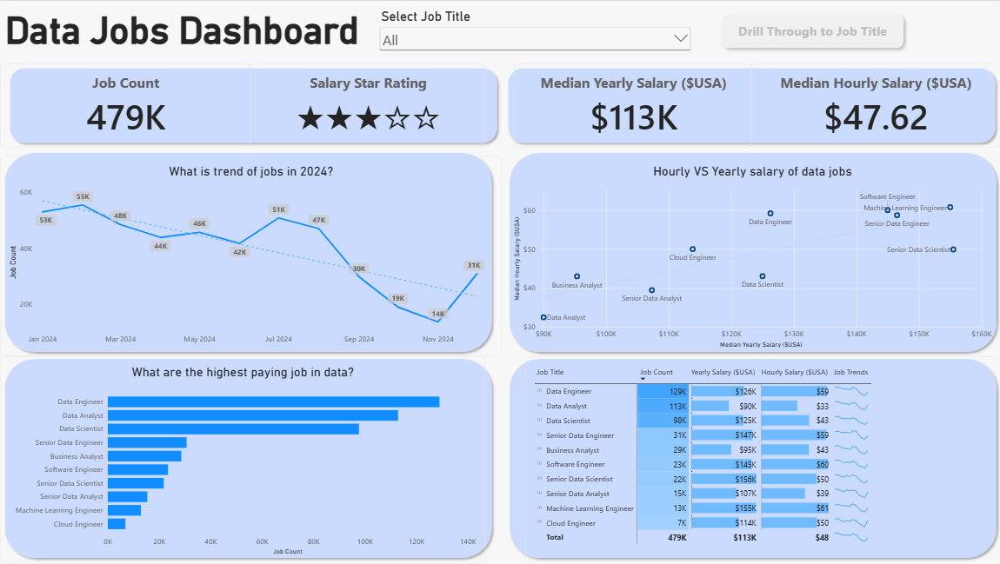
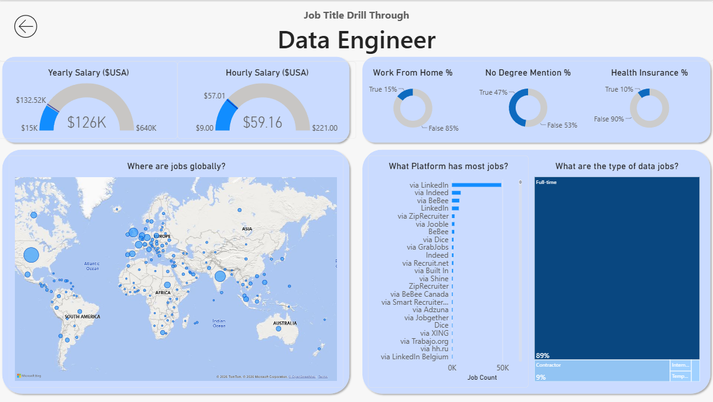

# 📊 Part 1: Learning Core Power BI Skills

> **Building my foundation in Power BI through guided practice.**

## 🎯 Project Overview

In this part, I followed an instructor-led tutorial to learn the fundamentals of building interactive dashboards in Power BI.

The project explores the data job market through job demand, salary comparisons, employment trends, and global job opportunities. More importantly, it helped me understand how to transform raw data into meaningful visualizations and organize them into an interactive report.

## 🖥️ Dashboard Preview

### 🔍 Page 1: Data Jobs Dashboard

This page provides an overview of the data job market, allowing users to explore job demand, salary trends, and differences across data-related roles.

**Key Features**
- 📈 **Job Market Trends** — Visualize changes in job postings over time.
- 💰 **Salary Comparison** — Compare median yearly and hourly salaries across job titles.
- 📊 **Job Demand Analysis** — Explore job counts across different data-related roles.
- 🎛️ **Interactive Filtering** — Use a job title slicer to explore specific roles.
- 📋 **Detailed Data Table** — Compare job counts, salary metrics, and job trends in one view.

### 🔍 Page 2: Job Title Drill-Through

This page demonstrates how users can drill through from the overview to a more detailed analysis of a selected job title.

The example focuses on **Data Engineer**, providing additional context about salary, remote-work availability, job platforms, and employment types.

**Key Features**
- 💵 **Salary Gauges** — Display yearly and hourly salary metrics.
- 🏠 **Work From Home Analysis** — Examine the proportion of job postings marked as remote.
- 🎓 **Job Requirement Indicators** — Explore mentions of degree requirements and health insurance benefits.
- 🌍 **Global Job Distribution** — Visualize where job opportunities are located.
- 🔗 **Drill-Through Navigation** — Navigate from the overview to a job-specific report.

## 🧠 What I Learned

Through this guided project, I developed foundational knowledge in the following areas

### 1. Data Transformation & Preparation
- Used Power Query for ETL and data shaping.
- Learned how to prepare data for analysis and visualization.

### 2. Basic Data Modeling
- Understood table relationships and their role in connecting data.
- Learned how data models support interactive reports.

### 3. Data Visualization
- Built bar, line, and scatter charts to communicate different types of insights.
- Used KPI cards and detailed tables to summarize key metrics.
- Explored map visualizations for geographical analysis.

### 4. Interactivity & Navigation
- Used slicers to filter report data.
- Explored buttons and bookmarks for page navigation.
- Implemented drill-through functionality to analyze individual job titles in greater detail.

## 💡 Key Takeaways

This project helped me understand the end-to-end workflow of building a Power BI dashboard, from preparing data to designing interactive reports.

It also showed me how different visuals and navigation features work together to make data easier to explore.

---

*📚 Learning approach: Instructor-led tutorial and hands-on practice.*