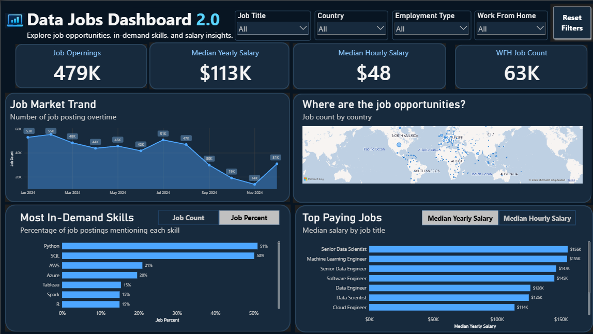

# 🚀 Part 2: Building a More Advanced Power BI Dashboard

> **From foundational Power BI skills to more flexible, interactive, and user-focused data analysis.**

## 🎯 Project Overview

Building on the foundational skills developed in Part 1, this project focuses on improving the Data Jobs Dashboard by applying more advanced Power BI techniques.

The goal was to create a more flexible and user-friendly report that helps job seekers explore the data job market, identify in-demand skills, compare salaries, and discover job opportunities across different countries.

Rather than simply displaying data, this version focuses on making information easier to explore and compare through interactive filtering and dynamic visualizations.

## 🖥️ Dashboard Preview

### 📊 Data Jobs Dashboard 2.0

The redesigned dashboard brings together job market trends, salary insights, skill demand, and geographical job distribution in a single interactive report.

### 🔍 Key Features

- 📌 **Job Market Overview** — Track job openings, median yearly and hourly salaries, and work-from-home job counts.
- 📈 **Job Market Trends** — Explore how the number of job postings changes over time.
- 🧠 **In-Demand Skills Analysis** — Identify frequently requested technical skills, such as Python, SQL, AWS, and Azure.
- 💰 **Salary Comparison** — Compare median salaries across data-related job titles.
- 🌍 **Global Job Opportunities** — Explore the geographical distribution of job postings.
- 🎛️ **Dynamic Metric Selection** — Switch between job counts and job percentages, or between yearly and hourly salary metrics.
- 🔎 **Advanced Filtering** — Filter results by job title, country, employment type, and work-from-home status.

---

## 🛠️ Skills Applied & Developed

### 🧹 1. Advanced Data Transformation with Power Query

Expanded my understanding of data preparation by working with more complex transformations and shaping data for analysis.

**Key Learning Areas:**
- Advanced data cleaning and transformation
- Data type management
- Preparing structured data for modeling and visualization

### 🗂️ 2. Data Modeling & Star Schema Principles

Explored more structured data modeling approaches to support analytical calculations and relationships between tables.

**Key Learning Areas:**
- Fact and dimension table concepts
- Star schema design principles
- Table relationships and filter propagation

### 🧮 3. Explicit DAX Measures

Moved beyond standard aggregations by working with explicit DAX measures to create reusable calculations.

**Key Learning Areas:**
- Using `CALCULATE()` to modify filter context
- Understanding filter context in DAX
- Calculating job counts, percentages, and salary metrics
- Creating measures that respond to slicer selections

### 🎛️ 4. Dynamic Visualizations & Parameters

Implemented interactive metric selection to allow users to explore different perspectives without creating separate charts for every measure.

**Examples from the Dashboard:**
- Switch between **Job Count** and **Job Percent** for skill demand analysis.
- Switch between **Median Yearly Salary** and **Median Hourly Salary** for job salary comparisons.

**Key Learning Areas:**
- Field parameters
- Dynamic metric selection
- Interactive report design

### 🌍 5. Geospatial Analysis

Used geographical visualizations to explore how job opportunities are distributed across countries.

**Key Learning Areas:**
- Mapping geographical job data
- Connecting map visuals with report filters
- Exploring job distribution across locations

### 🎨 6. Dashboard Design & User Experience

Redesigned the report with a consistent dark theme and a clearer visual hierarchy.

**Key Improvements:**
- A consistent navy and blue color palette
- KPI cards for important job market metrics
- More accessible filters and navigation
- Dynamic chart interactions
- A reset button for clearing slicer selections

### ⚡ 7. Report Performance & Usability

Explored how data modeling, DAX calculations, and visual interactions can affect report usability and performance.

This helped me better understand the importance of designing dashboards that are not only visually appealing but also efficient and easy to navigate.

---

## 🔄 From Part 1 to Part 2

| Area | Part 1: Foundation | Part 2: Improvement |
|---|---|---|
| Data Preparation | Basic Power Query | Advanced transformations |
| Data Modeling | Table relationships | Star schema principles |
| Calculations | Standard aggregations | Explicit DAX measures |
| Visualizations | Core charts and KPI cards | Dynamic metric-driven visuals |
| Filtering | Basic slicers | Multiple interactive filters |
| Navigation | Buttons and drill-through | Reset filters and improved usability |
| Dashboard Design | Guided layout | Refined, user-focused design |

## 💡 Key Takeaways

This project helped me move beyond simply creating visuals in Power BI toward understanding how data modeling, DAX, and interactive design work together to support data exploration.

One of my most valuable learnings was how dynamic parameters can make a dashboard more flexible by allowing users to switch between different analytical metrics within the same visual.

I also gained a better understanding of how dashboard design decisions can influence the way users interpret and interact with data.

## 🔮 Future Improvements

To make this dashboard even more useful for job seekers, I would like to explore:

- 🧩 **Skill Explorer** — Compare skill demand across different job titles.
- 💵 **Salary Explorer** — Analyze salary differences by role and country.
- 🏠 **Remote Job Insights** — Explore remote-work opportunities across job markets.
- 📊 **Job Market Comparisons** — Help users compare career opportunities using multiple metrics.

---

*📚 This project builds on an instructor-led learning experience, with a focus on applying and extending Power BI skills through hands-on dashboard development.*